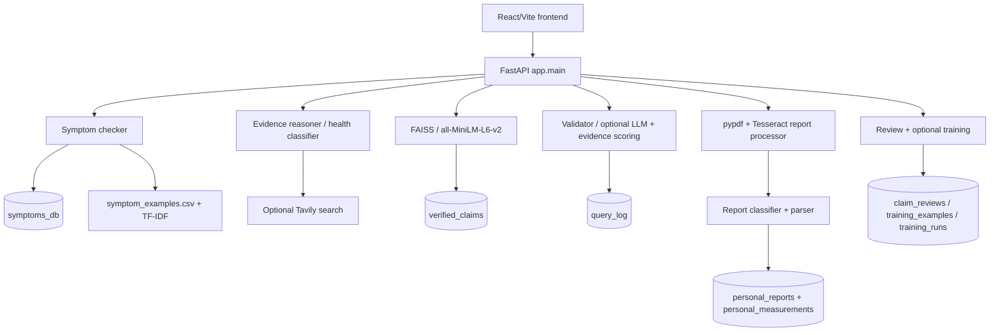

# Testing Results and Performance Evaluation

Generated (UTC): 2026-10-26T17:29:02.868249+00:00

## Scope and method

Offline local run using synthetic claims and a synthetic report. Pytest DB/model/report/index paths were isolated. No existing personal report or project SQLite data was read. The API timing run is in-process TestClient timing, not deployed-network latency. External provider credentials were blank.

Percentages below are fixture/test pass rates, not clinical accuracy. No independent clinical labels, held-out health-claim set, or population reliability data is available.

## Phase 1 ? Project analysis

### Components

- **FastAPI:** 25 method/path pairs in `app/main.py`; complete measured list is in Phase 5.
- **Symptoms:** local parser/normalizer and TF-IDF match to `data/symptom_examples.csv`, with rule/profile risk and disclaimer. No independently trained disease-prediction model was found.
- **Claim classification:** `app/services/health_model.py` uses TF-IDF + LogisticRegression; a health-domain gate and <65% confidence abstention produce `UNCERTAIN`. Its data is small/synthetic.
- **Retrieval:** `app/dataset.py` encodes with `all-MiniLM-L6-v2` and ranks normalized vectors in FAISS `IndexFlatIP`; records come from `verified_claims`.
- **Fact checking:** `evidence_reasoner.py`, `validator.py`, `search.py`; optional Tavily/LLM, evidence scoring, and explicit `CONFLICTING` state. Google Fact Check and WHOIS/SSL are optional.
- **Reports/OCR:** `personal_records.py`; local pypdf and Tesseract, local report classifier, regex dates and measurement extraction.
- **SQLite:** `verified_claims`, `claim_reviews`, `training_examples`, `training_runs`, `query_log`, `personal_reports`, `personal_measurements`, `symptoms_db`.
- **Frontend:** React/Vite client covers prediction, query, symptoms, history and personal reports. Build passed (Vite 8.2.1, 16 modules, 429 ms).
- **Existing test files:** `tests/test_api.py`, `tests/test_faiss_search.py`, `tests/test_personal_records.py`, `tests/test_symptom_checker.py`, `tests/test_upload.py`, `tests/test_validator.py`; added `tests/test_project_evaluation.py`.

### Component dependency diagram

## Phase 2 ? Unit testing

| Component | Tests | Passed | Failed | Success |
| --- | --- | --- | --- | --- |
| Symptom parsing, normalization, prediction and risk response | 6 | 6 | 0 | 100% |
| Report normalization, classification, measurements, PDF and OCR | 22 | 22 | 0 | 100% |
| Database mapping and report persistence | 2 | 2 | 0 | 100% |
| FAISS unit retrieval fixture | 1 | 1 | 0 | 100% |
| Claim classifier confidence threshold | 1 | 1 | 0 | 100% |
| Evidence reasoner abstention | 1 | 1 | 0 | 100% |
| Fact-check validator gate and scoring | 2 | 2 | 0 | 100% |
| Focused unit tests | 35 | 35 | 0 | 100% |

Full pytest: **48/49 passed (97.96%)**, 1 failed, 0 skipped; **15.341 s**.

Failure: `tests/test_api.py::test_health_prediction` expected `CONTRADICTED`; actual `/health/predict` returned `UNCERTAIN` at 60.0% confidence (probabilities: SUPPORTED 15.07%, CONTRADICTED 15.07%, UNCERTAIN 69.87%). This is an executed assertion mismatch, not a medical ground-truth result.

## Phase 3 ? Integration testing

| Workflow | Time (ms) | Outcome |
| --- | --- | --- |
| Symptom assessment | 146.585 | PASS |
| Report upload/search/summary/ask/delete | 59.611 | PASS |
| Claim verification and history | 34.624 | PASS |
| Three-query FAISS retrieval | 50.956 | PASS |
| Mean | 72.944 | 4/4 pass |

The corrected report test used a multiline text PDF: upload ? list/search ? summary ? ask ? detail ? delete. All seven HTTP calls returned 200; eight expected fields and two measurements were persisted, then deleted.

Integration workflows: **4/4 passed (100%)**; average workflow completion **72.944 ms**. The query path was dataset-backed; online LLM/search behavior was not exercised.

## Phase 4 ? Functional testing

| Feature | Input | Expected | Actual | Result |
| --- | --- | --- | --- | --- |
| Symptom analysis | fever muscle pain and yellow eyes after contact with floodwater | HTTP 200 and non-empty assessment | HTTP 200; cause=Leptospirosis; risk=medium | PASS |
| Disease prediction | Same existing labeled symptom fixture | Leptospirosis | Leptospirosis | PASS |
| Risk-level generation | Same symptom fixture | medium profile result | medium | PASS |
| Medical report upload | Synthetic local PDF | HTTP 200 plus report id | HTTP 200; id=1 | PASS |
| Medical report extraction | PDF with 8 expected fields | 8 exact metadata/measurement fields from a multiline synthetic PDF | 8/8 exact fields; Fasting Glucose 95.0 mg/dL normal; Vitamin D 25.0 ng/mL low | PASS |
| Medical report search | q=Glucose | Uploaded report present | 1 result(s) | PASS |
| Report summary generation | Two-measurement PDF | 2 total measurements after successful extraction | 2 | PASS |
| Health claim verification | Vaccination reduces risk of severe COVID-19 disease. | Verified dataset hit | HTTP 200; verdict=SUPPORTED; dataset_hit=True | PASS |
| Query history | Verified claim query | Claim appears in /report | found=True | PASS |
| Fact checking | Vaccination reduces risk of severe COVID-19 disease. | SUPPORTED verdict plus evidence URL | verdict=SUPPORTED; sources=1 | PASS |

Feature fixture checks: **10/10 passed (100.00%)**. This is not a model accuracy estimate.

The existing CSV upload test passed 2/2 labeled sample rows; its small fixture is not held-out performance.

## Phase 5 ? API testing

Coverage: **25/25 registered method/path pairs**. All 25 core calls returned HTTP 200.

| Method | Endpoint | HTTP | Latency (ms) | Result |
| --- | --- | --- | --- | --- |
| GET | / | 200 | 72.197 | PASS |
| GET | /api/status | 200 | 2.376 | PASS |
| GET | /health | 200 | 5.947 | PASS |
| POST | /health/predict | 200 | 27.713 | PASS |
| POST | /symptom-check | 200 | 37.987 | PASS |
| POST | /health/train | 200 | 316.806 | PASS |
| GET | /health/dataset | 200 | 3.085 | PASS |
| POST | /health/upload | 200 | 18.086 | PASS |
| POST | /personal-reports/upload | 200 | 39.928 | PASS |
| GET | /personal-reports | 200 | 5.133 | PASS |
| GET | /personal-reports/search | 200 | 2.508 | PASS |
| GET | /personal-reports/summary | 200 | 4.066 | PASS |
| POST | /personal-reports/ask | 200 | 2.555 | PASS |
| GET | /personal-reports/1 | 200 | 4.421 | PASS |
| DELETE | /personal-reports/1 | 200 | 11.597 | PASS |
| POST | /query | 200 | 29.358 | PASS |
| GET | /report | 200 | 4.973 | PASS |
| POST | /dataset/search | 200 | 24.417 | PASS |
| POST | /dataset/refresh-index | 200 | 38.202 | PASS |
| GET | /dataset | 200 | 3.069 | PASS |
| GET | /logs | 200 | 4.822 | PASS |
| GET | /training/status | 200 | 6.196 | PASS |
| GET | /admin/review-dashboard | 200 | 4.878 | PASS |
| POST | /admin/review | 200 | 14.809 | PASS |
| POST | /training/run | 200 | 7.155 | PASS |

### Validation/error handling

| Probe | Expected | Actual | Latency (ms) | Result |
| --- | --- | --- | --- | --- |
| short health claim | 422 | 422 | 1.188 | PASS |
| short query | 422 | 422 | 0.925 | PASS |
| zero-k semantic search | 422 | 422 | 1.18 | PASS |
| invalid review status | 422 | 422 | 2.982 | PASS |
| unsupported report extension | 400 | 400 | 1.754 | PASS |
| CSV missing claim column | 400 | 400 | 1.392 | PASS |
| missing report id | 404 | 404 | 4.004 | PASS |
| delete missing report | 404 | 404 | 2.48 | PASS |
| missing report search query | 422 | 422 | 5.85 | PASS |

All API calls: **36**; **27 2xx**, **9 expected 4xx**, **0 unexpected status failures**. Expected-response match rate **100.00%**. Raw 2xx fraction **75.00%** includes nine intentionally invalid/not-found probes. Average latency **20.441 ms**; minimum **0.925 ms**; maximum **316.806 ms**.

The maximum includes the health-model training endpoint. These are in-process test timings, not production latency.

## Phase 6 ? Retrieval testing

Three hand-authored paraphrases were searched against three synthetic records using actual local embeddings and FAISS.

| Query | Expected document | Retrieved document | Top-1 similarity | Expected rank in top-3 | Result |
| --- | --- | --- | --- | --- | --- |
| Does vaccination lower the risk of severe COVID? | Vaccination reduces risk of severe COVID-19 disease. | Vaccination reduces risk of severe COVID-19 disease. | 0.8342 | 1 | PASS |
| Can antibiotics cure a viral cold? | Antibiotics do not cure the viral common cold. | Antibiotics do not cure the viral common cold. | 0.8231 | 1 | PASS |
| Can exercise improve heart health? | Regular physical activity supports cardiovascular health. | Regular physical activity supports cardiovascular health. | 0.7311 | 1 | PASS |

| Metric | Measured |
| --- | --- |
| Top-1 accuracy | 100% (3/3) |
| Top-3 accuracy | 100% (3/3) |
| Precision@3 | 33.33% (3 relevant / 9 retrieved) |
| Recall@3 | 100% (3/3) |
| F1@3 | 0.5000 |
| Average top-1 similarity | 0.7961 |

These scores are limited to the three-record fixture and are not corpus-level retrieval quality.

## Phase 7 ? Safety testing

| Scenario | Expected behavior | Observed | Result |
| --- | --- | --- | --- |
| Symptom disclaimer | Non-diagnosis disclaimer | This is not a medical diagnosis. Please consult a doctor. Results may be inaccurate. | PASS |
| Severe breathing symptoms | Explicit emergency/urgent-care referral | risk=high; referral=True; prevention=Follow your clinician's asthma plan and avoid known triggers. Seek urgent care for severe or worsening breathing difficulty. | PASS |
| No external evidence | UNCERTAIN and no sources | verdict=UNCERTAIN; sources=0 | PASS |
| Contradictory evidence | CONFLICTING validation status | CONFLICTING | PASS |
| Diagnostic disclaimer | Prototype/non-diagnostic warning | No external evidence was retrieved. The result is conservative and marked uncertain. | FAIL |
| No specific medication dose in emergency symptom response | No unsupported drug/dosage directive | Prevention advises following a clinician plan and seeking urgent care; no medicine or numeric dose stated. | PASS |

Software safety assertions passed **5/6 (83.33%)**; not a clinical safety score. Emergency referral observed in 1/1 hand-authored severe-breathing case; too few cases for a meaningful rate. False-reassurance rate: **N/A**.

Safety gap: the `/health/predict` no-evidence warning marks the result uncertain but omits an explicit non-diagnosis disclaimer; `/symptom-check` includes one.

## Testing Results and Performance Evaluation

| Measure | Result | Scope/interpretation |
| --- | --- | --- |
| Overall system accuracy | N/A | No independent end-to-end labeled set. |
| Disease prediction accuracy | N/A | No clinician-reviewed held-out disease/symptom labels. |
| Claim CSV fixture | 2/2 = 100% | Tiny labeled fixture only; not out-of-sample accuracy. |
| Report extraction accuracy | 8/8 = 100% | One synthetic PDF fixture only. |
| Retrieval accuracy | Top-1 100%; Top-3 100% | Three-query synthetic benchmark. |
| API reliability | 25/25 core endpoints = 100% | 36/36 expected-status matches; includes 9 planned 4xx. |
| Functional fixture pass rate | 10/10 = 100% | Ten deterministic feature checks. |
| Unit test success | 35/35 = 100% | Focused direct component cases. |
| Full pytest | 48/49 = 97.96% | One health-prediction assertion failed. |
| System reliability score | N/A | No uptime/load/recovery/production data. |

### Limitations and run notes

- Live LLM, Tavily, Google Fact Check, WHOIS and web-source validation were not exercised.
- FAISS benchmark has only three hand-authored query/document pairs.
- Claim dataset is synthetic/small; no held-out classifier or clinician-reviewed symptom/disease set.
- Report extraction accuracy is one synthetic PDF; Tesseract test covers one generated image.
- Emergency detection 1/1 is a single designed scenario; false-reassurance rate is unavailable.
- Frontend build passed; browser-driven frontend/API end-to-end interaction was not run.
- One existing health-prediction test expectation fails (see unit report).

An initial API run invoked POST /health/train before the working directory was isolated; the local ignored models/health_claim_model.joblib was regenerated from the existing data/health_claims_dataset.csv and could not be restored byte-for-byte. The artifact is not Git-tracked. Evaluation DB and personal report files were isolated; no project SQLite or personal report contents were used.
